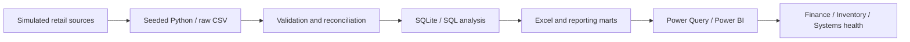
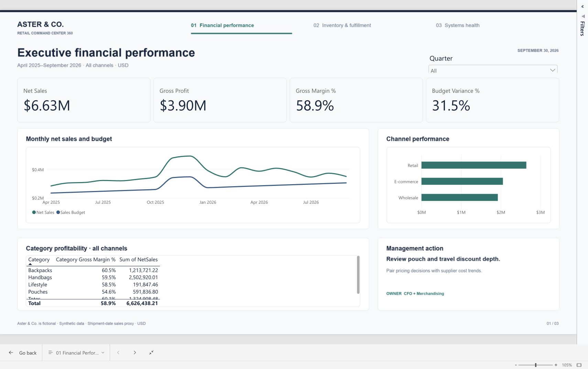
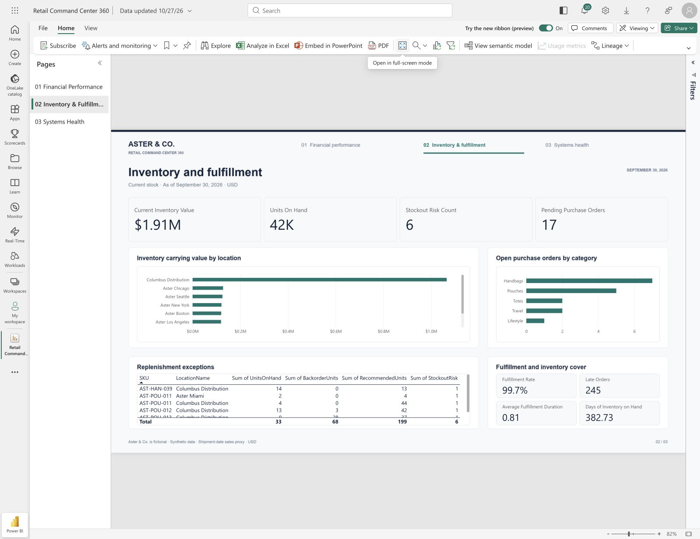
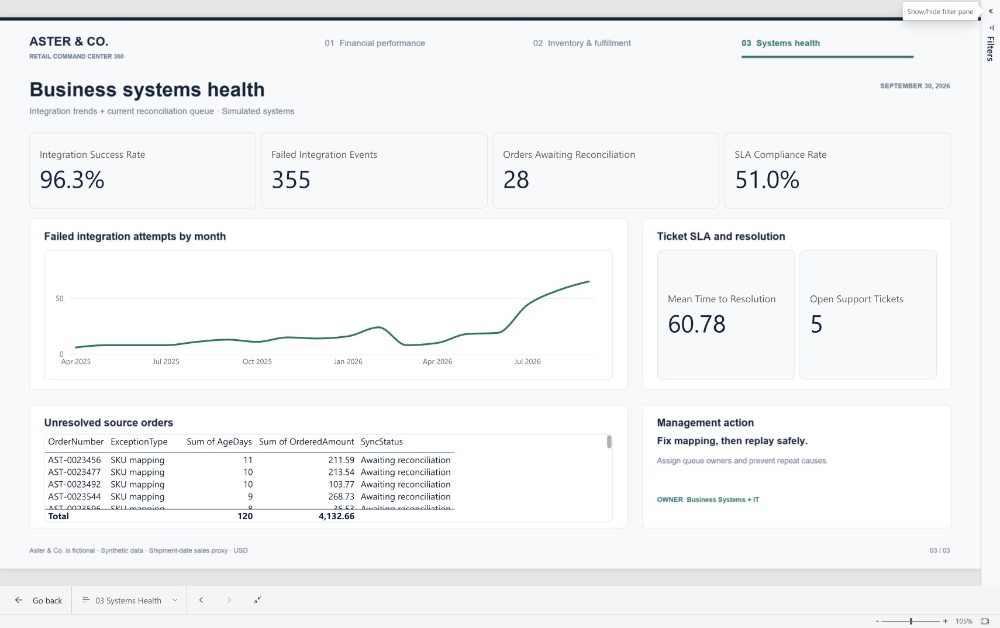

# Retail Command Center 360
**Find margin pressure, inventory imbalance and missing orders in one connected retail intelligence project.**

Aster & Co. is a fictional accessories retailer. This portfolio uses reproducible synthetic data and simulated ERP, commerce, warehouse and support records.
Reporting cutoff: **September 30, 2026**. Currency: USD. Data period: April 2025–September 2026.

## Start here
1. Read [the executive summary](docs/executive_summary.md) for the business story.
2. Check [Power BI implementation status](reports/powerbi_status.md) for what has actually been built and tested.
3. Open [the Power BI-ready workbook](data/retail360_powerbi.xlsx) or use the detailed CSVs and SQLite store.
4. Follow [the build guide](powerbi/build_guide.md) and [the five-minute demonstration](docs/interview_demo.md).

## Business problem
Sales are growing, but category discounts, supplier cost increases, inventory allocation and synchronization failures weaken operating performance.
The analyst must connect the symptoms, verify the numbers, and assign practical next actions.

## Evidence from the sample
| Finding | Verified result |
|---|---|
| Comparable Q3 sales growth | 9.9% |
| Comparable Q3 gross margin | 59.7% → 56.9% |
| Unreconciled commerce orders | 28, including 4 with no event |
| Ordered-value exposure | $4,133, not established lost revenue |
| Current at-risk SKU/location pairs | 6 |
| SLA compliance | 51.0% |
| Automated dataset checks | 275 passed, zero invalid references |

## Architecture


## Dashboard overview
**Executive financial performance:** net sales, gross profit/margin, budget and channel/category trends.
**Inventory and fulfillment:** stock carrying value, SKU/location risk, customer promises and purchasing.
**Business systems health:** failed attempts, expected orders missing ERP links, ticket SLA and corrective ownership.

The visual direction uses navy, teal and amber, restrained cards and clear action tables. Any generated preview is labeled as such; native screenshots are kept separately.

## Technology and model
Python, pandas, NumPy, SQLite SQL, Power Query M and DAX. The optional Excel export uses the artifact-tool authoring runtime.
The logical dataset has 20 tables, including 24,000 orders, 40,573 order lines,
200 SKUs, 28 suppliers and 28,800 monthly SKU/location snapshots.
See [ERD](docs/entity_relationship_diagram.md), [dictionary](data/data_dictionary/data_dictionary.md) and [model configuration](powerbi/model_documentation.md).

## Reproduce the analytical core
```bash
python -m venv .venv
source .venv/bin/activate
python -m pip install -r requirements.txt
python scripts/run_all.py
```
On Windows activate `.venv\Scripts\activate`. No paid API key is needed.
The seed and raw CSV SHA-256 hashes are in `data/scenario.json` and `data/manifest.json`.
`reports/reproducibility.json` records an independent regeneration with all 20 raw file hashes matching.
The pipeline runs 275 dataset checks, seven control tests, eight supplemental aggregate controls and 15 analytical SQL queries.
The optional Excel writer requires the artifact-tool runtime; use `node scripts/build_workbook.mjs`, then the same command with `--operations`.
Cloud reports are updated separately. Rebuilding local files does not refresh the saved Power BI report or its dated screenshots.
Open `data/processed/retail360.sqlite` to explore `sql/business_analysis.sql`; results are retained as `reports/sql_analysis_01.csv` through `15.csv`.

## Recommendations
Assign unresolved orders, correct mapping before idempotent replay, validate shortage transfers, review purchase approval delays,
introduce category discount controls and address recurring incident causes. Owners and proposed measures are in [process improvements](docs/process_improvement.md).
No production benefits are claimed.

## Project documentation
[BRD](docs/business_requirements.md) · [Functional specification](docs/functional_requirements.md) ·
[Data flow](docs/data_flow_diagram.md) · [Mapping](docs/data_mapping.md) · [UAT](docs/uat_test_plan.md) ·
[Validation evidence](reports/validation_report.md) · [Resume wording](docs/resume_bullets.md)

## Limitations and next steps
Sales is a shipment-date operational proxy. No OPEX, tax, freight allocation or audited accounting profit is available.
Full-detail data supports deeper analysis; the browser workbook uses compact reporting grains.
Production refresh, real system connections, RLS deployment and operational changes require additional implementation and acceptance.
See [assumptions](docs/assumptions_and_limitations.md) and [Power BI status](reports/powerbi_status.md).

## Native report and submission files

[Open the editable Power BI report](https://app.powerbi.com/groups/me/reports/45421c92-9cfc-4bca-ae5d-4f64fcd1b2e3). Access requires the owner account or separately granted permissions.
Three native pages, 51 DAX measures and 17 dimension relationships are implemented. Read [native validation evidence](reports/powerbi_status.md) for tested interactions and remaining extensions.





Use [the portfolio brief](Retail360_Portfolio_Brief.pdf) for a short offline walkthrough.
It contains a written case summary and actual native browser captures; it is a snapshot PDF assembled locally.
The two Excel imports are [core reporting tables](data/retail360_powerbi.xlsx) and [supplemental operations](data/retail360_operations.xlsx).
For a hiring manager, send the brief with a repository/package link and disclose synthetic data.
Check report access from the recipient's account before relying on a Power BI URL; public access has not been enabled.
Keep the full raw dataset and SQL available for technical review.

## Browser portfolio and publication

Repository: [sriram369/retail-command-center-360](https://github.com/sriram369/retail-command-center-360).
The browser portfolio source is `docs/index.html`; the captured dashboard walkthrough is `docs/demo.html`.
The repository is private while public-visibility approval is pending. See [publication status](reports/publication_status.md).
Native Power BI public embedding is disabled in the current report menu. The browser walkthrough shows actual native report captures and is explicitly labeled as a captured demonstration.

To preview locally:
```bash
python -m http.server 8768 --bind 127.0.0.1 --directory docs
```
Open `http://127.0.0.1:8768/`. The page tabs work by mouse and keyboard. No external analytics or authentication is used.
