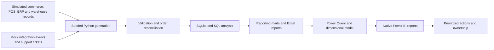

<!-- portfolio-readme:curated -->
# Retail Command Center 360

**A Business Systems Analyst portfolio connecting retail finance, inventory, fulfillment, and application reliability.**

[Public case study](https://sriram369.github.io/retail-command-center-360/) · [Dashboard walkthrough](https://sriram369.github.io/retail-command-center-360/demo.html) · [PDF brief](https://sriram369.github.io/retail-command-center-360/assets/Retail360_Portfolio_Brief.pdf) · [Project downloads](https://github.com/sriram369/retail-command-center-360/releases/tag/v0.1.0.0)

**Author:** Sriram Naidu Thota

**Stack:** Power BI Service · DAX · Power Query · SQL · Python · pandas · NumPy

**Scope:** Fictional company, reproducible synthetic data, and simulated business systems.

> The public walkthrough and PDF open without signing in. The walkthrough shows actual captures of the native Power BI report. The live report currently requires account permission because its “Publish to web” option is disabled.


## The business question

**Sales are growing. Why are margin and operational performance under pressure?**

Aster & Co. is a fictional premium accessories retailer with seven U.S. stores, e-commerce, wholesale, a distribution warehouse, and multiple suppliers. Its simulated business records expose connected problems: discount and cost pressure, uneven inventory allocation, delayed replenishment, missing ERP orders, and recurring support incidents.

This project translates those symptoms into business requirements, a consistent analytical model, tested KPIs, three native Power BI pages, and an action plan with clear ownership.

**Period:** April 2025–September 2026 · **Reporting cutoff:** September 30, 2026 · **Currency:** USD

## Findings that drive decisions

| Finding in the synthetic business | Verified result | Management implication |
|---|---|---|
| Sales growth with margin pressure | Comparable Q3 sales grew **9.9%**; gross margin fell from **59.7% to 56.9%**, a **2.75 percentage-point decline** | Review pouch/travel discounts alongside supplier costs and returns |
| Inventory imbalance | **$1.91M** of current stock, approximately **383 days** of historical COGS cover, and **6 at-risk SKU/location pairs** | Check allocation, donor availability, and delayed receipts before buying more |
| Missing ERP orders | **28 unreconciled orders**, including **4 with no integration event** | Reconcile expected source orders against ERP links, including absent webhooks |
| Reconciliation exposure | **$4,132.66** of ordered value awaiting reconciliation | Prioritize the queue; this is exposure, not established lost revenue |
| Integration reliability | **96.3% success**, **355 failed events**, and **306 correctly ignored duplicates** | Repair mapping and use idempotent replay |
| Support performance | **51.0% SLA compliance**, **60.78 hours** mean resolution time, and **5 open tickets** | Address repeat causes and confirm business reconciliation before closing exceptions |

Gross profit dollars still increased in comparable Q3 periods; the deterioration is in the **margin rate**. Calculations and denominators are recorded in [KPI controls](reports/kpi_controls.json), the [executive summary](docs/executive_summary.md), and [process recommendations](docs/process_improvement.md).

## Three connected Power BI pages

The saved Power BI Service implementation contains **16 tables, 51 native DAX measures, and 17 dimension relationships**.

| Report page | Business question | Implemented views |
|---|---|---|
| **01 · Financial Performance** | Are growth and budget performance producing healthy margins? | Sales, gross profit/margin, budget variance, monthly actual vs. budget, channel sales, category profitability, and a quarter slicer |
| **02 · Inventory & Fulfillment** | Is stock in the right place, and are orders being fulfilled? | Inventory value/units, risk, open purchasing, location balances, replenishment exceptions, fulfillment rate/time, late orders, and inventory cover |
| **03 · Systems Health** | Which application failures are affecting business records? | Integration success/failures, reconciliation queue, SLA compliance, resolution time, open tickets, and corrective ownership |

<details>
<summary>View the native Inventory & Fulfillment page</summary>


</details>

<details>
<summary>View the native Systems Health page</summary>


</details>

[Open the public walkthrough](https://sriram369.github.io/retail-command-center-360/demo.html). Its page tabs support mouse and keyboard navigation. Native tables scroll; the full exception queues are supplied as CSV.

## From source records to management action



### Dataset and modeling choices

- **20 source tables:** 24,000 orders, 40,573 order lines, 200 SKUs, 28 suppliers, 4,000 fictional customer profiles, and 28,800 monthly SKU/location snapshots.
- **One consistent company:** shipments, returns, stock movements, purchasing, integration events, and tickets use valid shared identifiers.
- **Explicit fact grains:** monthly finance by channel/location; order- and incident-level records; current inventory by SKU/location.
- **Single-direction dimension relationships:** no ambiguous many-to-many joins or direct fact-to-fact aggregate joins.
- **Budget comparisons at their defined grain:** aggregate actuals before joining budgets to prevent order-line multiplication.

See the [ERD](docs/entity_relationship_diagram.md), [data dictionary](data/data_dictionary/data_dictionary.md), [source-to-target mappings](docs/data_mapping.md), and [semantic model configuration](powerbi/model_documentation.md).

### Controls behind the numbers

Inventory uses perpetual moving weighted-average cost, four-decimal valuation, and original issue-cost reversals for returns. Daily balances support trailing inventory ratios; historical metrics are not inferred from a single current snapshot.

Net sales uses signed shipment and return postings and is separate from ordered revenue. SLA uses continuous elapsed time and includes overdue open tickets in its eligible population. Integration success excludes correctly ignored duplicates, which do not create duplicate finalized sales.

Intentionally injected business exceptions remain visible and are distinguished from accidental dataset errors.

## Validation evidence

| Check | Recorded result | Evidence |
|---|---|---|
| Dataset integrity and reconciliation | **275 passed**, zero invalid references | [Validation report](reports/validation_report.md) |
| Corruption and boundary tests | **7 passed** | [Tests](tests/test_controls.py) · [Execution output](reports/unittest_results.txt) |
| Supplemental aggregate controls | **8 passed** | [Operations controls](reports/operations_controls.json) |
| Executable SQL analyses | **15 completed** | [SQL source](sql/business_analysis.sql) · [Results](reports/sql_execution.json) |
| Independent raw-data regeneration | **20 of 20 file hashes matched** | [Reproducibility evidence](reports/reproducibility.json) |
| Native DAX and report interactions | Controls matched; Q3 slicer and cutoff isolation verified | [Power BI evidence](reports/powerbi_status.md) |
| Excel export parity | Both workbooks matched generated values and types | [Release checks](reports/release_checks.json) |
| Public access | **11 anonymous HTTP checks passed**; public PDF matched the verified local file | [Access checks](reports/public_access_checks.json) |

Tests deliberately inject invalid references, duplicate ERP business keys, and canceled-order inconsistencies into disposable databases. SLA cases cover exact deadlines, immature open tickets, and zero denominators. Python/SQL validation and native DAX execution are recorded separately; neither is presented as stakeholder sign-off.

## Explore or reproduce

### Review the portfolio

Start with the [public case study](https://sriram369.github.io/retail-command-center-360/), [dashboard walkthrough](https://sriram369.github.io/retail-command-center-360/demo.html), or [five-page PDF](Retail360_Portfolio_Brief.pdf). The [interview guide](docs/interview_demo.md) provides a five-minute demonstration of the business story and evidence.

### Rebuild the analytical core

```bash
git clone https://github.com/sriram369/retail-command-center-360.git
cd retail-command-center-360
python3 -m venv .venv
source .venv/bin/activate
python -m pip install -r requirements.txt
python scripts/run_all.py
```

On Windows PowerShell, activate with `.venv\Scripts\Activate.ps1`. Use an available Python interpreter in place of `python3` if needed.

The pipeline regenerates source data and reporting marts, runs reconciliation, validation, SQL analyses, and control tests, and rebuilds generated documentation and analytical previews. The random seed and assumptions are in [scenario.json](data/scenario.json). **No paid API key is required.**

The maintained README is preserved during rebuilds. Local regeneration does not refresh the saved cloud report, captured evidence, or published website.

### Inspect SQL or continue in Power BI

- Open [retail360.sqlite](data/processed/retail360.sqlite) in a SQLite client and run [business_analysis.sql](sql/business_analysis.sql). Results are retained under `reports/sql_analysis_01.csv` through `reports/sql_analysis_15.csv`.
- Import the included [core Excel workbook](data/retail360_powerbi.xlsx) and [operations workbook](data/retail360_operations.xlsx). Detailed CSVs are under `data/raw/` and `data/processed/`.
- Follow the [Power BI build guide](powerbi/build_guide.md) for table aliases, relationships, TMDL, DAX, typed Power Query, theme, and page construction.
- The optional Excel writer requires the artifact-tool runtime. Workbooks are already exported; core CSV/SQL reproduction does not depend on that runtime.

To preview the browser portfolio locally:

```bash
python -m http.server 8768 --bind 127.0.0.1 --directory docs
```

Open `http://127.0.0.1:8768/`.

## Business Systems Analyst deliverables

| Deliverable | Purpose |
|---|---|
| [Business requirements](docs/business_requirements.md) | Background, stakeholders, objectives, risks, and acceptance criteria |
| [Functional specification](docs/functional_requirements.md) | Report behavior, date semantics, calculations, access, and exception workflows |
| [Data flow](docs/data_flow_diagram.md) · [ERD](docs/entity_relationship_diagram.md) | System boundaries, information movement, entities, and relationships |
| [Data mapping](docs/data_mapping.md) · [Dictionary](data/data_dictionary/data_dictionary.md) | Source-to-target rules, fields, definitions, and grains |
| [UAT plan](docs/uat_test_plan.md) | Financial, inventory, integration, return, reference-data, and SLA cases |
| [Process improvements](docs/process_improvement.md) | Before/after reconciliation workflow, priorities, owners, and proposed controls |
| [Executive summary](docs/executive_summary.md) | Findings, implications, corrective actions, and limitations |
| [Power BI build guide](powerbi/build_guide.md) · [Page specifications](powerbi/page_specifications.md) | Reproduction and visual configuration |

The optional [AI analysis component](docs/ai_analysis.md) accepts validated aggregate metrics and keeps recommendations separate from deterministic totals. Its included output is explicitly a demonstration; no live Claude API execution is claimed.

## Repository map

```text
retail-command-center-360/
├── data/       # Synthetic sources, reporting marts, SQLite, Excel and dictionary
├── scripts/    # Generation, validation, reconciliation, analysis and packaging
├── sql/        # Schema, control queries and 15 business analyses
├── powerbi/    # DAX, Power Query, TMDL, theme, backgrounds and build instructions
├── docs/       # BSA documentation and public browser portfolio
├── reports/    # KPI controls, query outputs and validation/publication evidence
├── tests/      # Corruption and boundary control tests
├── visuals/    # Native captures and separately labeled analytical previews
└── Retail360_Portfolio_Brief.pdf
```

## Scope, access, and extensions

This is a **synthetic portfolio project**, with simulated ERP/commerce/warehouse/support records. No real vendor integration, production deployment, realized savings, or audited accounting results are claimed. Operating expenses, tax, freight allocation, and multi-currency accounting are outside the model.

The public website and PDF require no authentication. The [original editable Power BI report](https://app.powerbi.com/groups/me/reports/45421c92-9cfc-4bca-ae5d-4f64fcd1b2e3) requires the owner account or granted permission. Public embedding is disabled; see [publication status](reports/publication_status.md). No PBIX or PBIP file is fabricated.

Native order/SKU drillthrough, scheduled refresh, deployed row-level security, and additional detailed charts are documented extensions. Supporting store/product rankings, fulfillment trends, ticket breakdowns, and priority analyses are supplied as SQL outputs and [detail visual specifications](powerbi/detail_visual_specifications.md).

See [assumptions and limitations](docs/assumptions_and_limitations.md) for financial definitions, date coverage, inventory ratio scope, and operational caveats.
