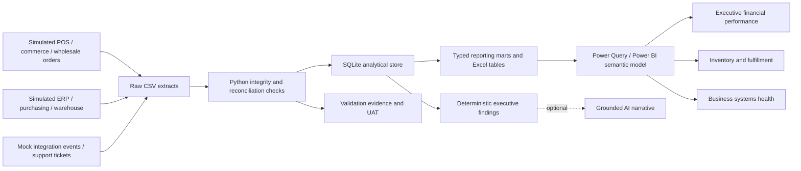

# Data flow and architecture
All source systems below are simulations. CSV files are the implemented extraction boundary.

Raw data is generated with stable keys. Processing derives additive reporting facts, current risk flags,
cutoff-aware reconciliation and historical inventory balances. AI never calculates financial totals.
