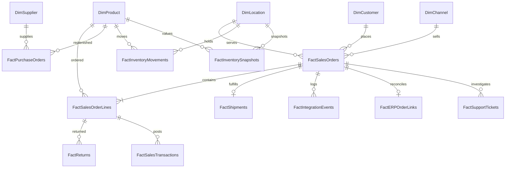

# Entity relationships
This logical ERD shows record ownership. The Power BI star uses dimensions to facts with single-direction filtering;
logical transactional links are not all activated as Power BI relationships.

