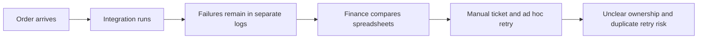
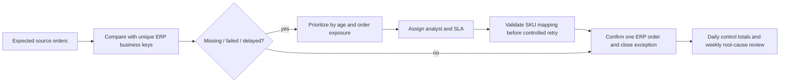

# Business process improvement
The changes below are recommendations. No production process has been changed.

## Before

## After

| Priority | Action | Owner | Proposed success measure |
|---|---|---|---|
| P1 / first week | Work 28 unresolved orders with $4,133 ordered-value exposure | Business systems analyst | Every exception owned and reconciled or explained |
| P1 / first week | Correct targeted SKU mapping and replay safely | Integration owner | No duplicate ERP business orders, declining unresolved queue |
| P1 / first week | Review 6 at-risk SKU/location pairs and overdue customer promises | Inventory lead | Backlog cleared with approved transfers or supplier expedite |
| P2 / first month | Set discount guardrails and category cost reviews | Merchandising / CFO | Stabilize margin with measured price-volume tradeoffs |
| P2 / first month | Introduce approval delegation and supplier promise tracking | Procurement lead | Reduce cohort approval and delivery delay |
| P2 / first month | Assign repeat root-cause tickets and SLA escalation | IT support lead | Raise SLA compliance from 51.0% baseline |

Targets are proposed controls, not claimed results. Transfer quantities require donor validation and consideration of shared warehouse stock before execution.
Replenishment suggestions are independent candidate quantities, not a globally optimized allocation plan.
